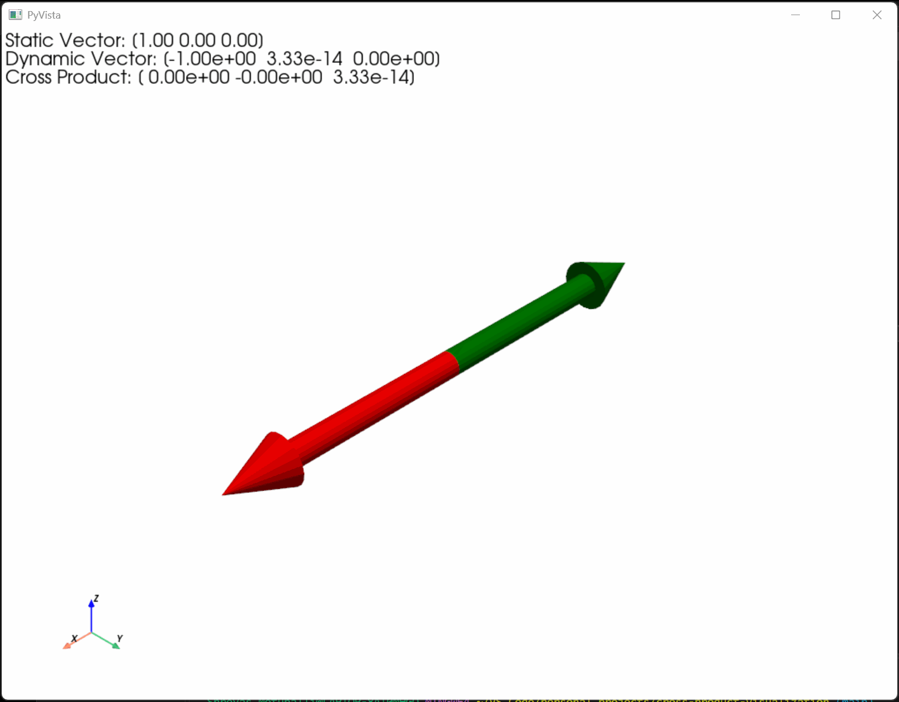

# Cross Product Visualization

An interactive, camera-controlled 3D visualization of vector cross products, animated in Python using the open-source PyVista library.



## Overview

This project demonstrates how the cross product between two vectors changes as one vector rotates in three-dimensional space. Using PyVista, the visualization displays three vectors as interactive 3D arrows:

- **Static Vector (Red):** A fixed vector pointing along the positive X-axis.
- **Dynamic Vector (Green):** A vector that continuously rotates within the XY plane.
- **Cross Product (Blue):** The cross product of the static and dynamic vectors, illustrating how the resulting perpendicular vector changes as the dynamic vector rotates.

The visualization updates in real time, with a text display in the upper-left corner showing the current coordinates of each vector, rounded to two decimal places.

## Features

- Real-time animation of a rotating 3D vector.
- Interactive camera controls for viewing the visualization from different angles.
- Dynamic cross-product calculations using NumPy.
- 3D arrow visualization with distinct colors for each vector.
- Live display of vector coordinates.
- Automatic hiding of the cross-product arrow when its magnitude approaches zero.

## Technologies Used

- **Python:** Core programming language.
- **NumPy:** Vector calculations, cross products, and magnitude calculations.
- **PyVista:** 3D visualization, arrow generation, camera controls, and animation.

## Installation and Setup

1. Clone or download this repository.
2. Navigate to the project directory.
3. Install the required dependencies:

```bash
pip install -r requirements.txt
```

4. Run the visualization:

```bash
python main.py
```

## Project Structure

```text
cross-product-visualization/
│
├── main.py
├── requirements.txt
└── README.md
```
